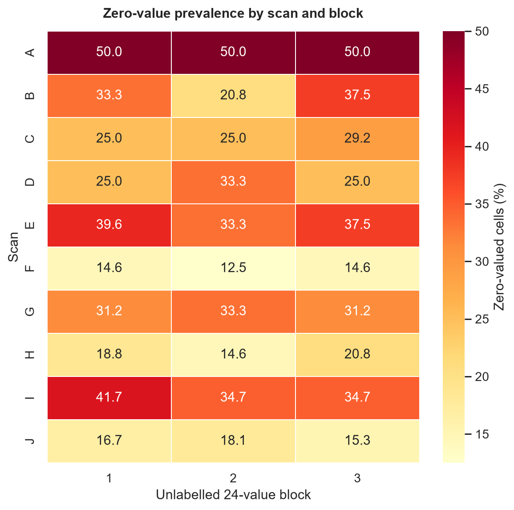
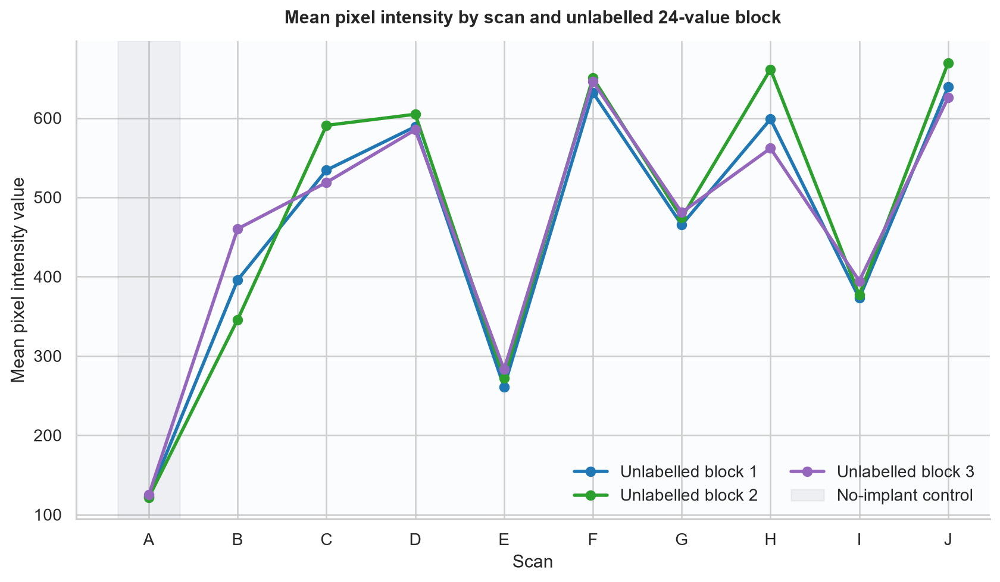
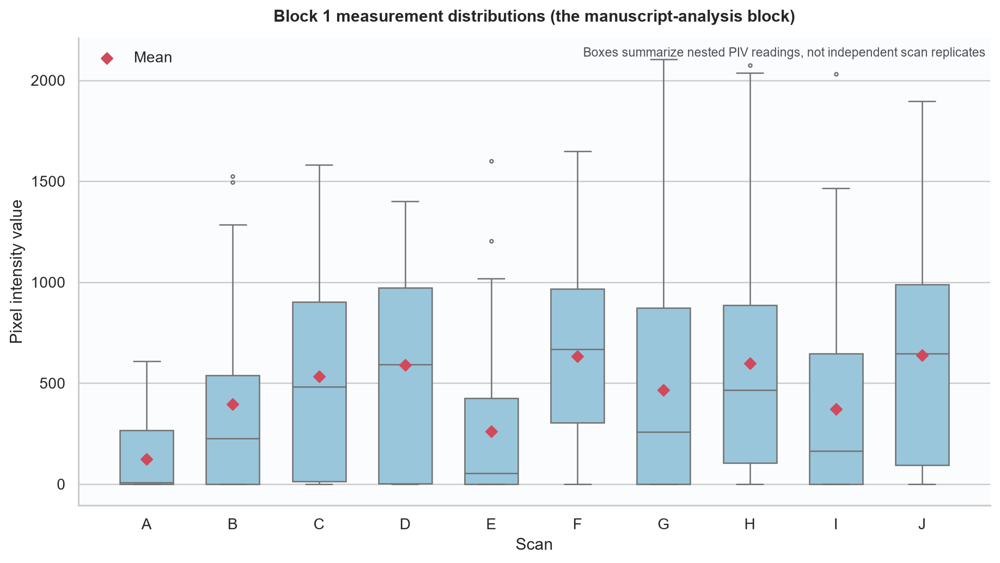
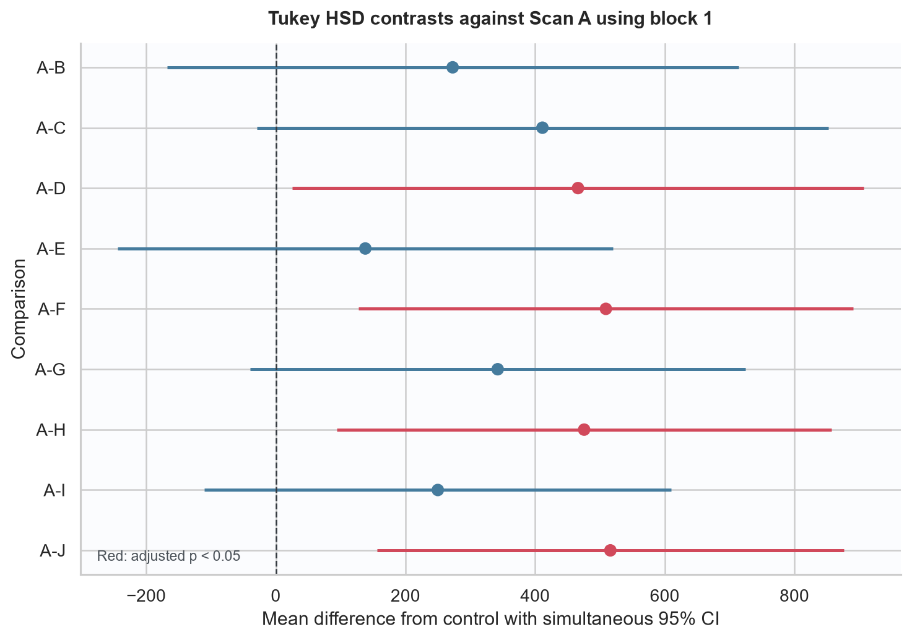
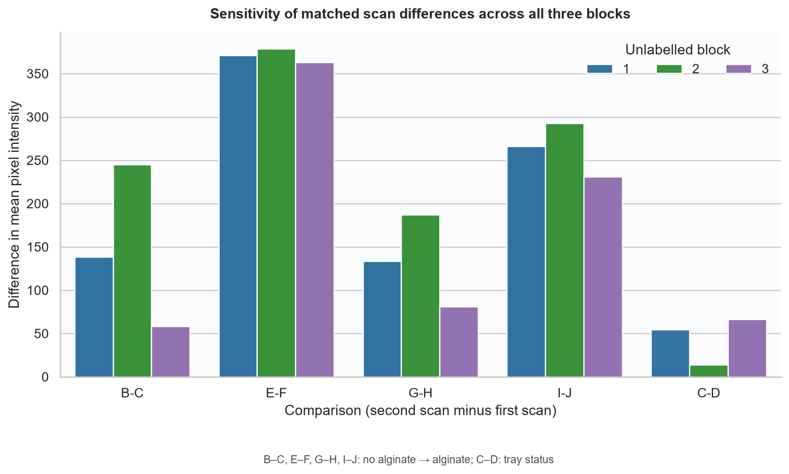

# CBCT alginate study: data audit and visualization report

Generated: 2026-10-21

## Executive finding

The workbook is structurally complete at the cell level, but it is not analysis-ready without a
data dictionary. It contains **1296 numeric measurements** across 18 implant-site
rows and 10 scans, arranged as three unlabelled blocks of 24 values. The manuscripts describe only
24 PIV measurements per site (eight points at three radii), while the workbook stores 72.

The published scan means reproduce for **9/10 scans** only when the
first 24-value block is used. The reported Scan A comparison p-values reproduce for
**9/9 contrasts** as a ten-group Tukey HSD on those same block 1
measurements. This makes the computation traceable, but it does not resolve whether block 1 was a
pre-specified endpoint or why blocks 2 and 3 were excluded.

Across all three blocks, all four like-for-like alginate contrasts (B–C, E–F, G–H, I–J) have a
positive descriptive change in mean PIV: **Yes**. This directional consistency is
useful, but it is not by itself evidence of statistical independence or generalizability.

> Privacy: the source workbook remains under `data/private/`, is ignored by Git, and is never
> exported in row-level form. This report and its CSV tables contain aggregates only.

## Workbook audit

| check | result | interpretation |
| --- | --- | --- |
| Worksheets | 1 | One worksheet expected |
| Worksheet extent | 32 × 74 | Includes notes/blank padding |
| Data rows / implant sites | 18 | Expected 18 |
| Scans | 10 | Expected A–J |
| Numeric measurements | 1296 | 18 sites × 72 cells |
| Missing/non-numeric values | 0 | Validated before analysis |
| Zero values | 358 | 27.6% of numeric cells |
| Negative values | 0 | None expected in current workbook |
| Minimum | 0.000 | Descriptive only |
| Maximum | 2627.658 | Descriptive only |
| Duplicate site codes | 0 | Site codes should be unique |
| Merged ranges | 6 | Scan labels span multi-site rows |
| Formula cells | 0 | Workbook contains values, not calculations |
| Comments | 0 | No embedded data notes |
| Tables/charts | 0/0 | No structured Excel table or chart |
| Non-empty note rows after data | 5 | Free-text requested comparisons |

Important structural observations:

- There is no header row, codebook, formula, validation rule, Excel table, or cell comment defining
  the 72 numeric columns.
- Six merged scan-label ranges require carrying the scan label down to secondary implant sites.
- 358 cells (27.6%) are exactly zero. Zero may be a valid
  PIV, clipping/background, or missingness encoded as zero; the workbook does not say which.
- Rows after the 18 data rows contain free-text requested comparisons, not observations.
- The workbook does not contain the qualitative Likert ratings described in the manuscripts, so
  inter-rater reliability and qualitative conclusions cannot be audited here.



## Manuscript mean reproduction

| scan_id | manuscript_mean | workbook_block_1_mean | difference | reproduces_at_2dp |
| --- | --- | --- | --- | --- |
| A | 123.0500 | 123.0490 | -0.0010 | Yes |
| B | 395.8400 | 395.8357 | -0.0043 | Yes |
| C | 534.3600 | 534.3561 | -0.0039 | Yes |
| D | 589.1700 | 589.1712 | 0.0012 | Yes |
| E | 261.0900 | 261.0915 | 0.0015 | Yes |
| F | 632.2100 | 632.2047 | -0.0053 | No |
| G | 465.3300 | 465.3335 | 0.0035 | Yes |
| H | 598.6700 | 598.6711 | 0.0011 | Yes |
| I | 372.9700 | 372.9688 | -0.0012 | Yes |
| J | 639.1300 | 639.1292 | -0.0008 | Yes |

Nine printed means match block 1 after rounding to two decimals. Scan F is 632.2047 in the workbook
(632.20 at two decimals) but 632.21 in both manuscripts. Every absolute discrepancy is below 0.006,
so block 1 is clearly the source, but the Scan F rounding/source-version discrepancy should be fixed.
Using all three blocks changes the descriptive scan means, demonstrating that the unlabelled block
choice is analytically material.





## Reported Scan A comparisons

| comparison | meandiff | manuscript_p | p_adjusted | lower | upper | reject | reproduces_at_3dp |
| --- | --- | --- | --- | --- | --- | --- | --- |
| A-B | 272.7868 | 0.6220 | 0.6220 | -168.0694 | 713.6429 | No | Yes |
| A-C | 411.3071 | 0.0910 | 0.0911 | -29.5490 | 852.1632 | No | Yes |
| A-D | 466.1222 | 0.0290 | 0.0286 | 25.2661 | 906.9783 | Yes | Yes |
| A-E | 138.0426 | 0.9790 | 0.9790 | -243.7501 | 519.8352 | No | Yes |
| A-F | 509.1557 | 0.0010 | 0.0011 | 127.3631 | 890.9483 | Yes | Yes |
| A-G | 342.2845 | 0.1230 | 0.1230 | -39.5081 | 724.0771 | No | Yes |
| A-H | 475.6221 | 0.0030 | 0.0034 | 93.8295 | 857.4148 | Yes | Yes |
| A-I | 249.9199 | 0.4530 | 0.4526 | -110.0377 | 609.8774 | No | Yes |
| A-J | 516.0802 | 0.0000 | 0.0003 | 156.1227 | 876.0377 | Yes | Yes |

These values reproduce a Tukey HSD across ten scan-ID groups using block 1. The individual PIV
locations are nested within implant sites and scan acquisitions. Treating them as independent
replicates is therefore a likely pseudoreplication risk unless the protocol supplies a defensible
independence argument. The control also has no implant, so its contrast with implant scans combines
implant presence, implant number/location, and alginate/tray conditions.



## Matched-configurations sensitivity analysis

| comparison | scenario | block | first_scan_mean | second_scan_mean | difference_second_minus_first |
| --- | --- | --- | --- | --- | --- |
| B-C | 1 implant | 1 | 395.8357 | 534.3561 | 138.5203 |
| B-C | 1 implant | 2 | 345.9175 | 590.7710 | 244.8534 |
| B-C | 1 implant | 3 | 460.3228 | 518.8053 | 58.4825 |
| E-F | 2 implants, contralateral arches | 1 | 261.0915 | 632.2047 | 371.1131 |
| E-F | 2 implants, contralateral arches | 2 | 272.0713 | 650.6218 | 378.5505 |
| E-F | 2 implants, contralateral arches | 3 | 283.0183 | 645.8947 | 362.8763 |
| G-H | 2 implants, same jaw | 1 | 465.3335 | 598.6711 | 133.3376 |
| G-H | 2 implants, same jaw | 2 | 474.1475 | 661.3955 | 187.2480 |
| G-H | 2 implants, same jaw | 3 | 480.9565 | 561.9211 | 80.9646 |
| I-J | 3 implants | 1 | 372.9688 | 639.1292 | 266.1603 |
| I-J | 3 implants | 2 | 376.7799 | 669.5394 | 292.7595 |
| I-J | 3 implants | 3 | 394.5961 | 625.5557 | 230.9596 |
| C-D | Alginate with tray vs tray removed | 1 | 534.3561 | 589.1712 | 54.8151 |
| C-D | Alginate with tray vs tray removed | 2 | 590.7710 | 604.7926 | 14.0216 |
| C-D | Alginate with tray vs tray removed | 3 | 518.8053 | 585.0799 | 66.2745 |



The manuscript's second p-value table is not reproduced by applying the same ten-group Tukey HSD
to block 1:

| comparison | manuscript_p | ten_group_tukey_p | difference | reproduces_at_3dp |
| --- | --- | --- | --- | --- |
| E-F | 0.0120 | 0.0067 | -0.0053 | No |
| G-H | 0.0870 | 0.9383 | 0.8513 | No |
| I-J | 0.0490 | 0.0321 | -0.0169 | No |

The analysis method for the manuscript's E–F, G–H, and I–J p-values must be documented before those
values are relied upon. In particular, the G–H value differs substantially from the ten-group Tukey
result, and the I–J conclusion is close to 0.05 in the manuscript.

## Statistical and study-design risks

1. **Unknown measurement schema.** The 72 cells per site need explicit block, radius, direction,
   slice/repeat, observer, units, and zero-value definitions.
2. **Unexplained endpoint selection.** Two-thirds of the stored measurements are absent from the
   manuscript mean calculation. Selection should be justified prospectively or all blocks analyzed
   with a stated repeated-measures model.
3. **Experimental unit ambiguity.** Multiple PIV points from the same scan are correlated technical
   measurements, not obviously independent biological/scan replicates. Confidence intervals and
   p-values based on point-level independence may be too optimistic.
4. **Condition confounding.** Scan identity changes implant number and location as well as alginate.
   Scan A additionally changes implant presence. Primary alginate inference should use matched
   configurations and appropriate scan/site-level replication.
5. **Incomplete audit trail.** Raw CBCT identifiers, ROI coordinates, slice identifiers, extraction
   code/version, and qualitative scores are not linked from the workbook.
6. **Reporting issues.** Report values below 0.001 as `p < 0.001`, never `p = 0.000`; report effect
   sizes and confidence intervals alongside multiplicity-adjusted p-values.

## Recommended remediation before submission

1. Freeze a data dictionary mapping every column and site code, including what blocks 1–3 and zero
   mean; preserve the workbook unchanged as a read-only source artifact outside Git.
2. Reconcile the primary endpoint with all three blocks and document why the existing manuscript
   used block 1 only.
3. Identify the experimental unit and fit a pre-specified repeated/mixed-effects analysis (for
   example, measurements nested within implant/site and scan/skull) only if the number of
   independent units supports it. Otherwise present this as an exploratory/descriptive ex-vivo
   study and collect independent replicates for confirmatory inference.
4. Document and reproduce the matched-pair p-value method. Prefer planned B–C, E–F, G–H, and I–J
   contrasts with effect estimates and confidence intervals.
5. Add qualitative ratings with blinded reader IDs and calculate agreement (weighted kappa or an
   ordinal mixed model, as justified by the protocol).
6. Version the analysis environment and record software versions, input checksum, and a signed-off
   analysis run for the final manuscript.

## Reproduction

```powershell
python -m pip install -e ".[dev]"
python -m cbct_artifact_analysis run
python -m pytest
python scripts/privacy_guard.py --tracked
```
