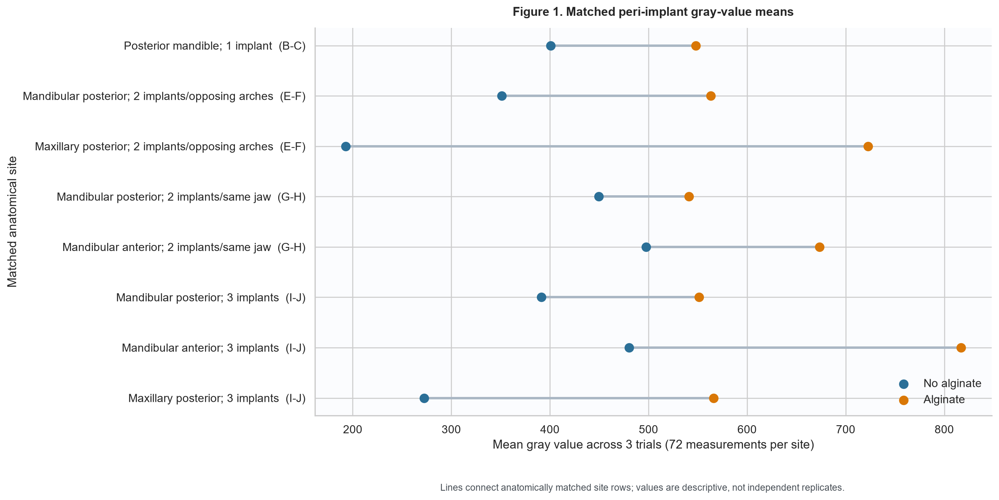
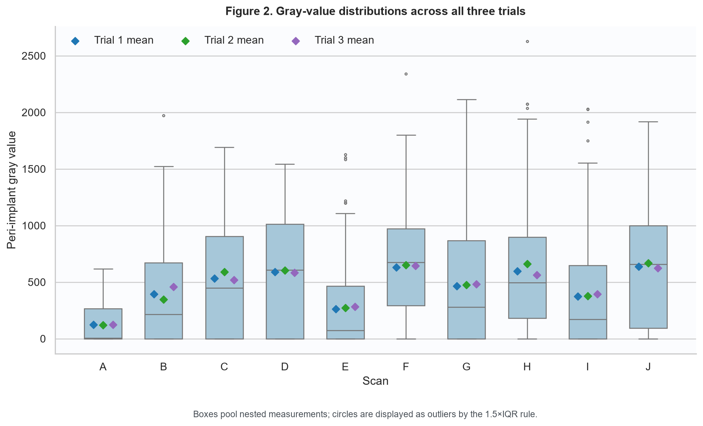

# CBCT alginate study: data audit and visualization report

Generated: 2026-10-21

## Executive finding

The workbook is structurally complete at the cell level, but it is not analysis-ready without a
data dictionary. It contains **1296 numeric measurements** across 18 implant-site
rows and 10 scans, arranged as three trial blocks of 24 values. The manuscripts describe 24 PIV
measurements per site (eight points at three radii); the spreadsheet contains three such trials.

The published scan means reproduce for **9/10 scans** only when the
first 24-measurement trial is used. The reported Scan A comparison p-values reproduce for
**9/9 contrasts** as a ten-group Tukey HSD on those same trial 1
measurements. This makes the computation traceable, but it does not resolve whether trial 1 was a
pre-specified endpoint or why trials 2 and 3 were excluded from the reported values.

Across all three trials, all four like-for-like alginate contrasts (B–C, E–F, G–H, I–J) have a
positive descriptive change in mean PIV: **Yes**. This directional consistency is
useful, but it is not by itself evidence of statistical independence or generalizability.

> Privacy: the source workbook remains under `data/private/`, is ignored by Git, and is never
> exported in row-level form. This report and its CSV tables contain aggregates only.

## Workbook audit

| check | result | interpretation |
| --- | --- | --- |
| Worksheets | 1 | One worksheet expected |
| Worksheet extent | 32 × 74 | Includes notes/blank padding |
| Data rows / implant sites | 18 | Expected 18 |
| Scans | 10 | Expected A–J |
| Numeric measurements | 1296 | 18 sites × 3 trials × 24 cells |
| Missing/non-numeric values | 0 | Validated before analysis |
| Zero values | 358 | 27.6% of numeric cells |
| Negative values | 0 | None expected in current workbook |
| Minimum | 0.000 | Descriptive only |
| Maximum | 2627.658 | Descriptive only |
| Duplicate site codes | 0 | Site codes should be unique |
| Merged ranges | 6 | Scan labels span multi-site rows |
| Formula cells | 0 | Workbook contains values, not calculations |
| Comments | 0 | No embedded data notes |
| Tables/charts | 0/0 | No structured Excel table or chart |
| Non-empty note rows after data | 5 | Free-text requested comparisons |

Important structural observations:

- There is no header row, codebook, formula, validation rule, Excel table, or cell comment defining
  the 72 numeric columns.
- Six merged scan-label ranges require carrying the scan label down to secondary implant sites.
- 358 cells (27.6%) are exactly zero. Zero may be a valid
  PIV, clipping/background, or missingness encoded as zero; the workbook does not say which.
- Rows after the 18 data rows contain free-text requested comparisons, not observations.
- The workbook does not contain the qualitative Likert ratings described in the manuscripts, so
  inter-rater reliability and qualitative conclusions cannot be audited here.


The complete scan/site/trial zero audit is exported as
`tables/zero_audit_by_scan_site_trial.csv`. Zeros are counted and retained; none are deleted or
converted to missing values.

## Corrected study framing

**Revised objective.** To characterize and compare peri-implant CBCT gray-value distributions at
standardized sampling locations around titanium implants in matched scan configurations acquired
with and without alginate, and to assess consistency across three trials and tray status.

**Revised hypothesis.** The null hypothesis is that matched alginate and no-alginate scans have the
same peri-implant gray-value distribution. The research hypothesis is that the distributions differ.
The direction and magnitude are estimated rather than presupposed. Gray-value differences are a
surrogate imaging outcome and do not, by themselves, demonstrate that metal artifact was reduced or
worsened.

The study remains a CBCT metal-artifact study. Optical scanning, dimensional accuracy, and material
shrinkage are outside the dataset and are not interpreted.

## Table 1. Experimental design

| scan | implant_number | anatomical_site | alginate | tray_status | design_note |
| --- | --- | --- | --- | --- | --- |
| A | 0 | Posterior mandible measurement site; no implant | No | None | No-implant control |
| B | 1 | Posterior mandible | No | None | One posterior mandibular implant |
| C | 1 | Posterior mandible | Yes | Present during acquisition | One posterior mandibular implant |
| D | 1 | Posterior mandible | Yes | Removed before acquisition | Manuscript labels alginate present; confirm what remained after tray removal |
| E | 2 | Mandibular posterior + maxillary posterior (same side) | No | None | Two implants in opposing arches |
| F | 2 | Mandibular posterior + maxillary posterior (same side) | Yes | Present during acquisition | Two implants in opposing arches |
| G | 2 | Mandibular anterior + mandibular posterior | No | None | Two implants in the same jaw |
| H | 2 | Mandibular anterior + mandibular posterior | Yes | Present during acquisition | Two implants in the same jaw |
| I | 3 | Mandibular anterior + mandibular posterior + maxillary posterior | No | None | Three implant locations |
| J | 3 | Mandibular anterior + mandibular posterior + maxillary posterior | Yes | Present during acquisition | Three implant locations |

## Table 2. Site-level descriptive statistics

Each row summarizes all 72 retained measurements for one site (3 trials × 24 measurements).

| scan_id | site_code | anatomical_site | n | mean | sd | median | q1 | q3 | iqr | minimum | maximum | zero_count | zero_percent |
| --- | --- | --- | --- | --- | --- | --- | --- | --- | --- | --- | --- | --- | --- |
| A | S1LB | Posterior mandible (no-implant control) | 72 | 123.3098 | 179.6441 | 4.3438 | 0.0000 | 266.3766 | 266.3766 | 0.0000 | 616.9375 | 36 | 50.0000 |
| B | S2LB | Posterior mandible | 72 | 400.6920 | 491.6053 | 215.4377 | 0.0000 | 671.4156 | 671.4156 | 0.0000 | 1971.1250 | 22 | 30.5556 |
| C | S3LB | Posterior mandible | 72 | 547.9775 | 513.9983 | 449.4687 | 0.0000 | 903.3193 | 903.3193 | 0.0000 | 1690.8515 | 19 | 26.3889 |
| D | S4LB | Posterior mandible | 72 | 593.0145 | 515.7432 | 607.0000 | 0.0000 | 1014.0469 | 1014.0469 | 0.0000 | 1543.9075 | 20 | 27.7778 |
| E | S5LB | Mandibular posterior | 72 | 351.2101 | 456.8922 | 95.1563 | 0.0000 | 611.6499 | 611.6499 | 0.0000 | 1629.3125 | 26 | 36.1111 |
| E | S5UB | Maxillary posterior | 72 | 192.9107 | 244.7664 | 38.3990 | 0.0000 | 325.8751 | 325.8751 | 0.0000 | 793.3708 | 27 | 37.5000 |
| F | S10LB | Mandibular posterior | 72 | 563.2133 | 440.1156 | 674.6428 | 104.7188 | 789.5121 | 684.7933 | 0.0000 | 1801.3773 | 18 | 25.0000 |
| F | S10UB | Maxillary posterior | 72 | 722.6008 | 452.7831 | 683.1755 | 355.2385 | 1047.0835 | 691.8450 | 0.0000 | 2341.0000 | 2 | 2.7778 |
| G | S6LB | Mandibular posterior | 72 | 449.6079 | 497.4688 | 251.6397 | 0.0000 | 866.7049 | 866.7049 | 0.0000 | 1542.5000 | 21 | 29.1667 |
| G | S6LF | Mandibular anterior | 72 | 497.3504 | 575.2653 | 313.8023 | 0.0000 | 845.9914 | 845.9914 | 0.0000 | 2113.7500 | 25 | 34.7222 |
| H | S7B | Mandibular posterior | 72 | 541.1817 | 506.7885 | 587.4907 | 0.8438 | 822.9752 | 822.1315 | 0.0000 | 2627.6576 | 18 | 25.0000 |
| H | S7F | Mandibular anterior | 72 | 673.4768 | 596.0397 | 439.8125 | 206.2582 | 990.2588 | 784.0006 | 0.0000 | 2074.0000 | 8 | 11.1111 |
| I | S8LB | Mandibular posterior | 72 | 391.5106 | 478.3267 | 217.1341 | 0.0000 | 731.4514 | 731.4514 | 0.0000 | 1748.0000 | 27 | 37.5000 |
| I | S8LF | Mandibular anterior | 72 | 480.3699 | 565.3731 | 268.9365 | 0.0000 | 812.7969 | 812.7969 | 0.0000 | 2030.9375 | 24 | 33.3333 |
| I | S8UB | Maxillary posterior | 72 | 272.4643 | 349.6717 | 103.1250 | 0.0000 | 532.5479 | 532.5479 | 0.0000 | 1311.2317 | 29 | 40.2778 |
| J | S9LB | Mandibular posterior | 72 | 551.1149 | 506.6424 | 562.0000 | 0.0000 | 939.6562 | 939.6562 | 0.0000 | 1819.1207 | 21 | 29.1667 |
| J | S9LF | Mandibular anterior | 72 | 816.9637 | 487.6195 | 784.1969 | 471.8347 | 1164.3750 | 692.5403 | 0.0000 | 1917.9375 | 3 | 4.1667 |
| J | S9UB | Maxillary posterior | 72 | 566.1455 | 513.3498 | 516.7410 | 38.5360 | 997.4064 | 958.8704 | 0.0000 | 1605.3750 | 12 | 16.6667 |

## Manuscript mean reproduction

| scan_id | manuscript_mean | workbook_trial_1_mean | difference | reproduces_at_2dp |
| --- | --- | --- | --- | --- |
| A | 123.0500 | 123.0490 | -0.0010 | Yes |
| B | 395.8400 | 395.8357 | -0.0043 | Yes |
| C | 534.3600 | 534.3561 | -0.0039 | Yes |
| D | 589.1700 | 589.1712 | 0.0012 | Yes |
| E | 261.0900 | 261.0915 | 0.0015 | Yes |
| F | 632.2100 | 632.2047 | -0.0053 | No |
| G | 465.3300 | 465.3335 | 0.0035 | Yes |
| H | 598.6700 | 598.6711 | 0.0011 | Yes |
| I | 372.9700 | 372.9688 | -0.0012 | Yes |
| J | 639.1300 | 639.1292 | -0.0008 | Yes |

Nine printed means match trial 1 after rounding to two decimals. Scan F is 632.2047 in the workbook
(632.20 at two decimals) but 632.21 in both manuscripts. Every absolute discrepancy is below 0.006,
so trial 1 is clearly the source, but the Scan F rounding/source-version discrepancy should be fixed.
Using all three trials changes the descriptive scan means, demonstrating that the trial selection
choice is analytically material.


## Reported Scan A comparisons

| comparison | meandiff | manuscript_p | p_adjusted | lower | upper | reject | reproduces_at_3dp |
| --- | --- | --- | --- | --- | --- | --- | --- |
| A-B | 272.7868 | 0.6220 | 0.6220 | -168.0694 | 713.6429 | No | Yes |
| A-C | 411.3071 | 0.0910 | 0.0911 | -29.5490 | 852.1632 | No | Yes |
| A-D | 466.1222 | 0.0290 | 0.0286 | 25.2661 | 906.9783 | Yes | Yes |
| A-E | 138.0426 | 0.9790 | 0.9790 | -243.7501 | 519.8352 | No | Yes |
| A-F | 509.1557 | 0.0010 | 0.0011 | 127.3631 | 890.9483 | Yes | Yes |
| A-G | 342.2845 | 0.1230 | 0.1230 | -39.5081 | 724.0771 | No | Yes |
| A-H | 475.6221 | 0.0030 | 0.0034 | 93.8295 | 857.4148 | Yes | Yes |
| A-I | 249.9199 | 0.4530 | 0.4526 | -110.0377 | 609.8774 | No | Yes |
| A-J | 516.0802 | 0.0000 | 0.0003 | 156.1227 | 876.0377 | Yes | Yes |

These values reproduce a Tukey HSD across ten scan-ID groups using trial 1. The individual PIV
locations are nested within implant sites and scan acquisitions. Treating them as independent
replicates is therefore a likely pseudoreplication risk unless the protocol supplies a defensible
independence argument. The control also has no implant, so its contrast with implant scans combines
implant presence, implant number/location, and alginate/tray conditions.


## Table 3. Matched comparisons

The four alginate/no-alginate scan pairs are matched at their component anatomical sites. C–D is
listed separately because both scans are labelled as containing alginate and differ in tray status.
No point-level p-values are presented in this table.

| comparison | comparison_type | anatomical_site | first_scan | first_condition | first_site_code | first_n | first_mean | first_median | second_scan | second_condition | second_site_code | second_n | second_mean | second_median | difference_second_minus_first | trial_difference_min | trial_difference_max | same_direction_all_trials |
| --- | --- | --- | --- | --- | --- | --- | --- | --- | --- | --- | --- | --- | --- | --- | --- | --- | --- | --- |
| B-C | Alginate vs no alginate | Posterior mandible; 1 implant | B | No alginate | S2LB | 72 | 400.6920 | 215.4377 | C | Alginate | S3LB | 72 | 547.9775 | 449.4687 | 147.2854 | 58.4825 | 244.8534 | Yes |
| E-F | Alginate vs no alginate | Mandibular posterior; 2 implants/opposing arches | E | No alginate | S5LB | 72 | 351.2101 | 95.1563 | F | Alginate | S10LB | 72 | 563.2133 | 674.6428 | 212.0033 | 190.8864 | 236.5314 | Yes |
| E-F | Alginate vs no alginate | Maxillary posterior; 2 implants/opposing arches | E | No alginate | S5UB | 72 | 192.9107 | 38.3990 | F | Alginate | S10UB | 72 | 722.6008 | 683.1755 | 529.6901 | 520.5697 | 534.8662 | Yes |
| G-H | Alginate vs no alginate | Mandibular posterior; 2 implants/same jaw | G | No alginate | S6LB | 72 | 449.6079 | 251.6397 | H | Alginate | S7B | 72 | 541.1817 | 587.4907 | 91.5737 | 25.8702 | 158.6961 | Yes |
| G-H | Alginate vs no alginate | Mandibular anterior; 2 implants/same jaw | G | No alginate | S6LF | 72 | 497.3504 | 313.8023 | H | Alginate | S7F | 72 | 673.4768 | 439.8125 | 176.1264 | 136.0590 | 215.8000 | Yes |
| I-J | Alginate vs no alginate | Mandibular posterior; 3 implants | I | No alginate | S8LB | 72 | 391.5106 | 217.1341 | J | Alginate | S9LB | 72 | 551.1149 | 562.0000 | 159.6044 | 146.3847 | 173.7491 | Yes |
| I-J | Alginate vs no alginate | Mandibular anterior; 3 implants | I | No alginate | S8LF | 72 | 480.3699 | 268.9365 | J | Alginate | S9LF | 72 | 816.9637 | 784.1969 | 336.5938 | 304.9441 | 369.0421 | Yes |
| I-J | Alginate vs no alginate | Maxillary posterior; 3 implants | I | No alginate | S8UB | 72 | 272.4643 | 103.1250 | J | Alginate | S9UB | 72 | 566.1455 | 516.7410 | 293.6812 | 241.5500 | 335.4873 | Yes |
| C-D | Tray sensitivity; both scans labelled alginate | Posterior mandible; tray present vs removed | C | Alginate | S3LB | 72 | 547.9775 | 449.4687 | D | Alginate; tray removed | S4LB | 72 | 593.0145 | 607.0000 | 45.0371 | 14.0216 | 66.2745 | Yes |

## Figure 1. Matched differences



## Figure 2. Intensity distributions



## Trial sensitivity analysis

| comparison | scenario | trial | first_scan_mean | second_scan_mean | difference_second_minus_first |
| --- | --- | --- | --- | --- | --- |
| B-C | 1 implant | 1 | 395.8357 | 534.3561 | 138.5203 |
| B-C | 1 implant | 2 | 345.9175 | 590.7710 | 244.8534 |
| B-C | 1 implant | 3 | 460.3228 | 518.8053 | 58.4825 |
| E-F | 2 implants, contralateral arches | 1 | 261.0915 | 632.2047 | 371.1131 |
| E-F | 2 implants, contralateral arches | 2 | 272.0713 | 650.6218 | 378.5505 |
| E-F | 2 implants, contralateral arches | 3 | 283.0183 | 645.8947 | 362.8763 |
| G-H | 2 implants, same jaw | 1 | 465.3335 | 598.6711 | 133.3376 |
| G-H | 2 implants, same jaw | 2 | 474.1475 | 661.3955 | 187.2480 |
| G-H | 2 implants, same jaw | 3 | 480.9565 | 561.9211 | 80.9646 |
| I-J | 3 implants | 1 | 372.9688 | 639.1292 | 266.1603 |
| I-J | 3 implants | 2 | 376.7799 | 669.5394 | 292.7595 |
| I-J | 3 implants | 3 | 394.5961 | 625.5557 | 230.9596 |
| C-D | Alginate with tray vs tray removed | 1 | 534.3561 | 589.1712 | 54.8151 |
| C-D | Alginate with tray vs tray removed | 2 | 590.7710 | 604.7926 | 14.0216 |
| C-D | Alginate with tray vs tray removed | 3 | 518.8053 | 585.0799 | 66.2745 |


## Paired trial-level analysis

| comparison | comparison_type | n_trial_pairs | first_mean_across_trials | second_mean_across_trials | mean_paired_difference | paired_difference_sd | difference_ci95_lower | difference_ci95_upper | exact_sign_flip_p |
| --- | --- | --- | --- | --- | --- | --- | --- | --- | --- |
| B-C | Alginate vs no alginate | 3 | 400.6920 | 547.9775 | 147.2854 | 93.4941 | -84.9669 | 379.5377 | 0.2500 |
| E-F | Alginate vs no alginate | 3 | 272.0604 | 642.9071 | 370.8467 | 7.8405 | 351.3698 | 390.3236 | 0.2500 |
| G-H | Alginate vs no alginate | 3 | 473.4791 | 607.3292 | 133.8501 | 53.1436 | 1.8342 | 265.8660 | 0.2500 |
| I-J | Alginate vs no alginate | 3 | 381.4483 | 644.7414 | 263.2931 | 30.9996 | 186.2860 | 340.3003 | 0.2500 |
| C-D | Tray sensitivity; both scans labelled alginate | 3 | 547.9775 | 593.0145 | 45.0371 | 27.4645 | -23.1885 | 113.2627 | 0.2500 |

The paired unit here is the 24-measurement trial mean, not an individual PIV location. The exact
two-sided sign-flip p-value is 0.25 for every comparison: with only three trial pairs, 0.25 is the
smallest attainable two-sided value when all three differences have the same sign. The t-based 95%
intervals are shown descriptively, but normality cannot be assessed with three pairs. More
importantly, the trials may be technical repeats rather than independent scan acquisitions. These
results therefore do not establish statistical significance; independent acquisition-level
replication is needed for confirmatory inference.

## Secondary RTM feasibility analysis

The grouped feasibility experiment is reported separately in `rtm_feasibility_report.md`. The
confirmed-design Regression Tsetlin Machine had pooled MAE/RMSE of 413.9/501.2 gray-value units,
compared with 400.7/485.8 for linear regression and 409.0/490.3 for the rule baseline. Its clauses
mainly restated condition, tray, anatomy, and trial patterns already visible descriptively. The RTM
should **not** be retained as a manuscript result; it may remain as a reproducible appendix or
future-work note. The model that adds positions 1–24 is sensitivity-only because those column
positions are not validated radius/direction labels.

The manuscript's second p-value table is not reproduced by applying the same ten-group Tukey HSD
to trial 1:

| comparison | manuscript_p | ten_group_tukey_p | difference | reproduces_at_3dp |
| --- | --- | --- | --- | --- |
| E-F | 0.0120 | 0.0067 | -0.0053 | No |
| G-H | 0.0870 | 0.9383 | 0.8513 | No |
| I-J | 0.0490 | 0.0321 | -0.0169 | No |

The analysis method for the manuscript's E–F, G–H, and I–J p-values must be documented before those
values are relied upon. In particular, the G–H value differs substantially from the ten-group Tukey
result, and the I–J conclusion is close to 0.05 in the manuscript.

## Statistical and study-design risks

1. **Incomplete measurement schema.** The 72 cells per site need explicit trial, radius, direction,
   slice/repeat, observer, units, and zero-value definitions.
2. **Unexplained endpoint selection.** Two-thirds of the stored measurements are absent from the
   manuscript mean calculation. Selection should be justified prospectively or all trials analyzed
   with a stated repeated-measures model.
3. **Experimental unit ambiguity.** Multiple PIV points from the same scan are correlated technical
   measurements, not obviously independent biological/scan replicates. Confidence intervals and
   p-values based on point-level independence may be too optimistic.
4. **Condition confounding.** Scan identity changes implant number and location as well as alginate.
   Scan A additionally changes implant presence. Primary alginate inference should use matched
   configurations and appropriate scan/site-level replication.
5. **Incomplete audit trail.** Raw CBCT identifiers, ROI coordinates, slice identifiers, extraction
   code/version, and qualitative scores are not linked from the workbook.
6. **Reporting issues.** Report values below 0.001 as `p < 0.001`, never `p = 0.000`; report effect
   sizes and confidence intervals alongside multiplicity-adjusted p-values.

## Recommended remediation before submission

1. Freeze a data dictionary mapping every column and site code, including what trials 1–3 and zero
   mean; preserve the workbook unchanged as a read-only source artifact outside Git.
2. Reconcile the primary endpoint with all three trials and document why the existing manuscript
   used trial 1 only.
3. Identify the experimental unit and fit a pre-specified repeated/mixed-effects analysis (for
   example, measurements nested within implant/site and scan/skull) only if the number of
   independent units supports it. Otherwise present this as an exploratory/descriptive ex-vivo
   study and collect independent replicates for confirmatory inference.
4. Document and reproduce the matched-pair p-value method. Prefer planned B–C, E–F, G–H, and I–J
   contrasts with effect estimates and confidence intervals.
5. Add qualitative ratings with blinded reader IDs and calculate agreement (weighted kappa or an
   ordinal mixed model, as justified by the protocol).
6. Version the analysis environment and record software versions, input checksum, and a signed-off
   analysis run for the final manuscript.
7. Keep the current RTM feasibility experiment outside the manuscript results unless independent
   validation data and a signed-off measurement-position map support a new analysis.

## Reproduction

```powershell
python -m pip install -e ".[dev]"
python -m cbct_artifact_analysis run
.\scripts\run_rtm_feasibility.ps1
python -m pytest
python scripts/privacy_guard.py --tracked
```
