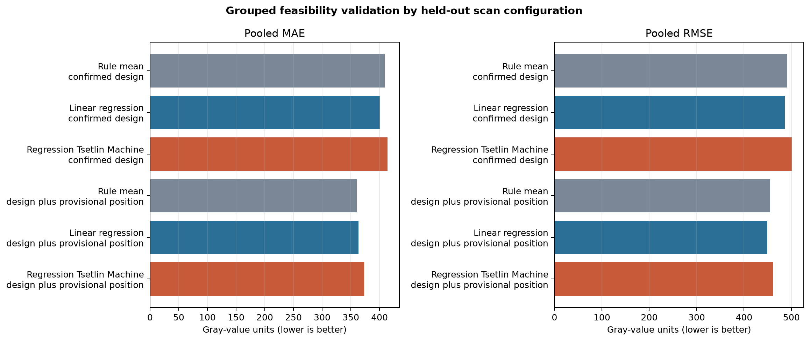

# Regression Tsetlin Machine feasibility report

## Decision

**Retain as a manuscript secondary analysis: No.** Do not retain the RTM as a manuscript result. The design-only RTM had pooled MAE/RMSE 413.9/501.2, versus 400.7/485.8 for linear regression and 409.0/490.3 for the rule baseline. Its supported clauses mostly restate condition, tray, anatomy, and trial patterns already visible in the descriptive summaries. Keep it as a reproducible feasibility appendix or future-work note.

This is an exploratory feasibility experiment, not a validated predictive system. The primary
paired analysis remains the trial-level matched analysis in
`tables/paired_trial_analysis.csv` and the descriptive matched comparisons in Table 3.

## Methods

- Target: recorded CBCT gray value; all zeros were retained.
- Validation: five leave-one-scan-configuration-out folds. B/C/D, E/F, G/H, and I/J are held out
  together as configuration families; Scan A forms the control fold. No scan identifier is a model
  feature.
- Confirmed-design features: alginate status, implant-count thresholds, anatomical site, tray
  status, and trial.
- Position sensitivity: adds the spreadsheet column index 1–24. This is explicitly **not** a
  validated radius/direction label and cannot support a clinical spatial interpretation.
- Encoding: predictors are represented as explicit Boolean one-hot or threshold features instead
  of opaque continuous bins, so extracted clause literals remain readable.
- Comparators: ordinary linear regression on the same binary design matrix and a training-fold-only
  hierarchical mean rule.
- Retention rule: before inspecting the results, require the confirmed-design RTM to improve both
  pooled MAE and RMSE by at least 5% over both baselines and provide at least three supported clauses
  with no more than four literals.
- RTM: `pyTsetlinMachine` 0.6.6; 200 clauses,
  `T=1000`, `s=2.75`, weighted clauses,
  `max_included_literals=6`, and
  50 epochs. Hyperparameters were fixed for this small feasibility run, not
  optimized against the validation folds.

The folds separate scan configurations, but the 1,296 target values are still repeated technical
measurements from only five configuration families. MAE and RMSE are descriptive out-of-group
errors, not precision estimates or evidence of clinical generalizability.

## Aggregate model comparison

| model | feature_set | validation | n_measurements | n_configuration_folds | pooled_mae | pooled_rmse | macro_fold_mae | macro_fold_rmse |
| --- | --- | --- | --- | --- | --- | --- | --- | --- |
| Rule mean | confirmed_design | 5-fold leave-one-scan-configuration-out | 1296 | 5 | 408.9537 | 490.3066 | 407.7755 | 478.8755 |
| Linear regression | confirmed_design | 5-fold leave-one-scan-configuration-out | 1296 | 5 | 400.6993 | 485.7801 | 381.5387 | 455.9855 |
| Regression Tsetlin Machine | confirmed_design | 5-fold leave-one-scan-configuration-out | 1296 | 5 | 413.9314 | 501.1713 | 394.0247 | 468.1971 |
| Rule mean | design_plus_provisional_position | 5-fold leave-one-scan-configuration-out | 1296 | 5 | 360.2947 | 454.761 | 363.9824 | 444.6568 |
| Linear regression | design_plus_provisional_position | 5-fold leave-one-scan-configuration-out | 1296 | 5 | 363.0836 | 448.096 | 354.0233 | 434.9999 |
| Regression Tsetlin Machine | design_plus_provisional_position | 5-fold leave-one-scan-configuration-out | 1296 | 5 | 373.323 | 460.6694 | 355.7946 | 432.929 |

## Per-configuration results

| model | feature_set | held_out_configuration | held_out_scans | n_test_measurements | mae | rmse |
| --- | --- | --- | --- | --- | --- | --- |
| Rule mean | confirmed_design | control_no_implant | A | 72 | 391.6408 | 422.7498 |
| Linear regression | confirmed_design | control_no_implant | A | 72 | 271.9224 | 302.0977 |
| Regression Tsetlin Machine | confirmed_design | control_no_implant | A | 72 | 276.1239 | 307.1545 |
| Rule mean | confirmed_design | posterior_one_implant | B,C,D | 216 | 442.528 | 511.5054 |
| Linear regression | confirmed_design | posterior_one_implant | B,C,D | 216 | 429.1886 | 515.7038 |
| Regression Tsetlin Machine | confirmed_design | posterior_one_implant | B,C,D | 216 | 442.2096 | 522.9109 |
| Rule mean | confirmed_design | opposing_arches_two_implants | E,F | 288 | 343.5918 | 418.4645 |
| Linear regression | confirmed_design | opposing_arches_two_implants | E,F | 288 | 342.6306 | 424.1396 |
| Regression Tsetlin Machine | confirmed_design | opposing_arches_two_implants | E,F | 288 | 371.5773 | 440.4167 |
| Rule mean | confirmed_design | same_jaw_two_implants | G,H | 288 | 449.5641 | 548.1788 |
| Linear regression | confirmed_design | same_jaw_two_implants | G,H | 288 | 450.5664 | 549.8595 |
| Regression Tsetlin Machine | confirmed_design | same_jaw_two_implants | G,H | 288 | 459.787 | 552.7225 |
| Rule mean | confirmed_design | three_implants | I,J | 432 | 411.5529 | 493.479 |
| Linear regression | confirmed_design | three_implants | I,J | 432 | 413.3853 | 488.1269 |
| Regression Tsetlin Machine | confirmed_design | three_implants | I,J | 432 | 420.4259 | 517.7808 |
| Rule mean | design_plus_provisional_position | control_no_implant | A | 72 | 391.6408 | 422.7498 |
| Linear regression | design_plus_provisional_position | control_no_implant | A | 72 | 292.1109 | 358.1635 |
| Regression Tsetlin Machine | design_plus_provisional_position | control_no_implant | A | 72 | 247.4778 | 277.6508 |
| Rule mean | design_plus_provisional_position | posterior_one_implant | B,C,D | 216 | 442.528 | 511.5054 |
| Linear regression | design_plus_provisional_position | posterior_one_implant | B,C,D | 216 | 366.2337 | 450.0578 |
| Regression Tsetlin Machine | design_plus_provisional_position | posterior_one_implant | B,C,D | 216 | 407.7293 | 510.1295 |
| Rule mean | design_plus_provisional_position | opposing_arches_two_implants | E,F | 288 | 239.8597 | 334.5534 |
| Linear regression | design_plus_provisional_position | opposing_arches_two_implants | E,F | 288 | 345.7102 | 427.5799 |
| Regression Tsetlin Machine | design_plus_provisional_position | opposing_arches_two_implants | E,F | 288 | 335.5238 | 412.3502 |
| Rule mean | design_plus_provisional_position | same_jaw_two_implants | G,H | 288 | 334.3308 | 460.9966 |
| Linear regression | design_plus_provisional_position | same_jaw_two_implants | G,H | 288 | 417.2587 | 508.7826 |
| Regression Tsetlin Machine | design_plus_provisional_position | same_jaw_two_implants | G,H | 288 | 411.2005 | 508.5044 |
| Rule mean | design_plus_provisional_position | three_implants | I,J | 432 | 411.5529 | 493.479 |
| Linear regression | design_plus_provisional_position | three_implants | I,J | 432 | 348.8029 | 430.4155 |
| Regression Tsetlin Machine | design_plus_provisional_position | three_implants | I,J | 432 | 377.0418 | 456.0098 |

## Clause audit

Each displayed clause is a conjunction. RTM regression clauses contribute non-negative votes when
true; “higher” or “lower” below is the observed mean target difference for rows where the clause was
true versus false, not a causal effect. Duplicate logical clauses are collapsed, and clauses with
fewer than 24 true or false observations are omitted to prevent narrow aggregate
disclosures.

| feature_set | clause_weight | literal_count | support_percent | observed_difference_true_minus_false | observed_association | clause |
| --- | --- | --- | --- | --- | --- | --- |
| confirmed_design | 18 | 1 | 16.6667 | 34.3326 | higher | anatomical_site=Posterior mandible |
| confirmed_design | 15 | 5 | 44.4444 | 247.5903 | higher | alginate=yes AND tray_status=Present during acquisition AND NOT anatomical_site=Posterior mandible (no-implant control) AND NOT tray_status=None AND NOT tray_status=Removed before acquisition |
| confirmed_design | 15 | 4 | 22.2222 | 232.159 | higher | alginate=yes AND NOT anatomical_site=Mandibular posterior AND NOT tray_status=None AND NOT trial=3 |
| confirmed_design | 15 | 3 | 14.8148 | -49.5692 | lower | implant_count>=3 AND NOT anatomical_site=Mandibular anterior AND NOT trial=2 |
| confirmed_design | 14 | 5 | 18.5185 | 159.1038 | higher | tray_status=Present during acquisition AND NOT implant_count>=3 AND NOT tray_status=None AND NOT tray_status=Removed before acquisition AND NOT trial=1 |
| confirmed_design | 14 | 3 | 16.6667 | 151.3479 | higher | alginate=yes AND trial=1 AND NOT trial=3 |
| confirmed_design | 14 | 5 | 20.3704 | 68.7471 | higher | implant_count>=1 AND NOT anatomical_site=Mandibular posterior AND NOT anatomical_site=Posterior mandible (no-implant control) AND NOT trial=1 AND NOT trial=3 |
| confirmed_design | 13 | 3 | 22.2222 | 220.9631 | higher | NOT anatomical_site=Mandibular posterior AND NOT tray_status=None AND NOT trial=1 |
| confirmed_design | 13 | 4 | 14.8148 | -104.2159 | lower | implant_count>=1 AND trial=3 AND NOT alginate=yes AND NOT anatomical_site=Posterior mandible (no-implant control) |
| confirmed_design | 12 | 2 | 14.8148 | 170.0293 | higher | anatomical_site=Mandibular anterior AND NOT trial=3 |
| confirmed_design | 12 | 5 | 16.6667 | 79.863 | higher | alginate=yes AND anatomical_site=Mandibular posterior AND NOT anatomical_site=Mandibular anterior AND NOT anatomical_site=Maxillary posterior AND NOT tray_status=None |
| confirmed_design | 12 | 6 | 25.9259 | 20.2557 | higher | implant_count>=1 AND implant_count>=2 AND trial=3 AND NOT anatomical_site=Posterior mandible AND NOT trial=1 AND NOT trial=2 |
| confirmed_design | 12 | 2 | 33.3333 | -15.9666 | lower | anatomical_site=Mandibular posterior AND NOT tray_status=Removed before acquisition |
| confirmed_design | 11 | 7 | 14.8148 | 250.0449 | higher | implant_count>=2 AND tray_status=Present during acquisition AND NOT anatomical_site=Mandibular posterior AND NOT anatomical_site=Posterior mandible (no-implant control) AND NOT tray_status=None AND NOT tray_status=Removed before acquisition AND NOT trial=1 |
| confirmed_design | 11 | 4 | 14.8148 | 134.3409 | higher | implant_count>=1 AND anatomical_site=Mandibular anterior AND NOT anatomical_site=Maxillary posterior AND NOT trial=2 |
| design_plus_provisional_position | 24 | 3 | 44.4444 | 247.5903 | higher | alginate=yes AND tray_status=Present during acquisition AND NOT tray_status=None |
| design_plus_provisional_position | 18 | 2 | 91.6667 | 352.5527 | higher | NOT provisional_measurement_position=11 AND NOT provisional_measurement_position=16 |
| design_plus_provisional_position | 18 | 6 | 37.037 | 293.1483 | higher | alginate=yes AND tray_status=Present during acquisition AND NOT provisional_measurement_position=5 AND NOT provisional_measurement_position=12 AND NOT provisional_measurement_position=16 AND NOT provisional_measurement_position=24 |
| design_plus_provisional_position | 17 | 2 | 4.1667 | 269.693 | higher | provisional_measurement_position=6 AND NOT provisional_measurement_position=3 |
| design_plus_provisional_position | 16 | 1 | 4.1667 | 511.3883 | higher | provisional_measurement_position=5 |
| design_plus_provisional_position | 15 | 1 | 4.1667 | 269.6769 | higher | provisional_measurement_position=23 |
| design_plus_provisional_position | 14 | 2 | 2.0833 | 861.3643 | higher | provisional_measurement_position=6 AND NOT tray_status=None |
| design_plus_provisional_position | 13 | 5 | 2.0833 | 610.7027 | higher | alginate=yes AND provisional_measurement_position=1 AND NOT tray_status=None AND NOT provisional_measurement_position=7 AND NOT provisional_measurement_position=16 |
| design_plus_provisional_position | 13 | 5 | 4.1667 | 511.3883 | higher | provisional_measurement_position=5 AND NOT provisional_measurement_position=1 AND NOT provisional_measurement_position=16 AND NOT provisional_measurement_position=18 AND NOT provisional_measurement_position=21 |
| design_plus_provisional_position | 13 | 4 | 45.8333 | -131.2757 | lower | implant_count>=1 AND NOT tray_status=Present during acquisition AND NOT provisional_measurement_position=2 AND NOT provisional_measurement_position=18 |
| design_plus_provisional_position | 12 | 5 | 18.5185 | 254.9383 | higher | anatomical_site=Mandibular anterior AND NOT provisional_measurement_position=6 AND NOT provisional_measurement_position=16 AND NOT provisional_measurement_position=18 AND NOT provisional_measurement_position=22 |
| design_plus_provisional_position | 11 | 5 | 2.0833 | 861.3643 | higher | provisional_measurement_position=6 AND NOT tray_status=None AND NOT provisional_measurement_position=3 AND NOT provisional_measurement_position=15 AND NOT provisional_measurement_position=22 |
| design_plus_provisional_position | 11 | 2 | 3.2407 | 430.173 | higher | provisional_measurement_position=23 AND NOT anatomical_site=Maxillary posterior |
| design_plus_provisional_position | 11 | 5 | 18.5185 | 250.4337 | higher | anatomical_site=Mandibular anterior AND NOT provisional_measurement_position=7 AND NOT provisional_measurement_position=8 AND NOT provisional_measurement_position=14 AND NOT provisional_measurement_position=16 |
| design_plus_provisional_position | 11 | 2 | 16.6667 | 194.7546 | higher | alginate=yes AND trial=2 |

Clause interpretation is provisional because scan condition, anatomy, implant count, tray status,
and alginate are partially confounded by design. Any clause containing
`provisional_measurement_position` must remain outside the manuscript until the 24-column mapping is
validated.

## Literature and implementation note

[Granmo (2018)](https://arxiv.org/abs/1804.01508) is the foundational Tsetlin Machine paper. The
regression extension is described separately by
[Abeyrathna et al. (2019)](https://arxiv.org/abs/1905.04206). The experiment uses the maintainers'
[pyTsetlinMachine implementation](https://github.com/cair/pyTsetlinMachine). Its compiled extension
is run in a pinned Linux container because the legacy package does not publish a compatible Windows
wheel for the project's Python environment.

## Privacy

The container image is built before any private-data mount. The analysis container runs without
network access, mounts the workbook read-only, and exports aggregate metrics and clause summaries
only. It does not write row-level observations or predictions.
